# ambientCG: Ground materials

**22 assets from [ambientCG](https://ambientcg.com), dedicated to the public domain under [CC0](https://docs.ambientcg.com/license/).** Use them in any game, free or paid, and change them however you like; no credit is needed.

PBR materials as 1K and 2K JPG maps (colour, normal GL and DX, roughness, AO, displacement), one folder per resolution. 886.2 MB in all.

This is a copy kept by [zuujis-cc0](https://github.com/zuujis-cc0) so game makers can take single files from GitHub. It is not made by or affiliated with ambientCG: the originals, often in more formats and higher resolutions, are on [ambientcg.com](https://ambientcg.com). If they help you, consider [supporting ambientCG](https://www.patreon.com/ambientCG).

Every file is listed in [MANIFEST.tsv](MANIFEST.tsv) with its size and SHA-256. More free assets: [the Zuujis collection](https://github.com/zuujis-cc0/free-game-assets#readme).

| | | | |
| :-: | :-: | :-: | :-: |
| <a href="Ground001">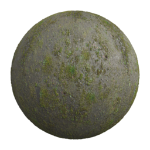</a> <b><a href="Ground001">Ground 001</a></b> by ambientCG · <a href="https://ambientcg.com/a/Ground001">source</a> | <a href="Ground002">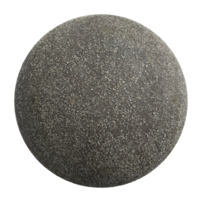</a> <b><a href="Ground002">Ground 002</a></b> by ambientCG · <a href="https://ambientcg.com/a/Ground002">source</a> | <a href="Ground003">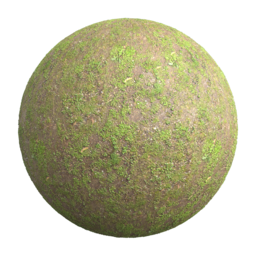</a> <b><a href="Ground003">Ground 003</a></b> by ambientCG · <a href="https://ambientcg.com/a/Ground003">source</a> | <a href="Ground004">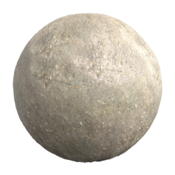</a> <b><a href="Ground004">Ground 004</a></b> by ambientCG · <a href="https://ambientcg.com/a/Ground004">source</a> |
| <a href="Ground005">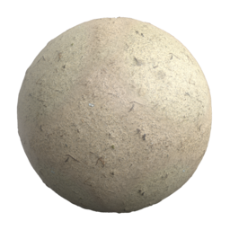</a> <b><a href="Ground005">Ground 005</a></b> by ambientCG · <a href="https://ambientcg.com/a/Ground005">source</a> | <a href="Ground006">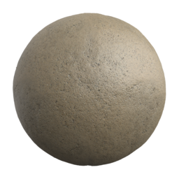</a> <b><a href="Ground006">Ground 006</a></b> by ambientCG · <a href="https://ambientcg.com/a/Ground006">source</a> | <a href="Ground007">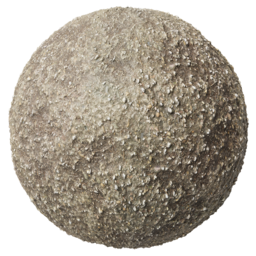</a> <b><a href="Ground007">Ground 007</a></b> by ambientCG · <a href="https://ambientcg.com/a/Ground007">source</a> | <a href="Ground008">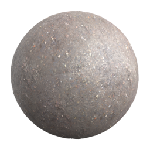</a> <b><a href="Ground008">Ground 008</a></b> by ambientCG · <a href="https://ambientcg.com/a/Ground008">source</a> |
| <a href="Ground009">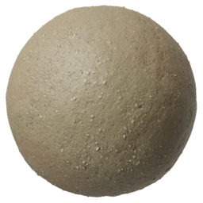</a> <b><a href="Ground009">Ground 009</a></b> by ambientCG · <a href="https://ambientcg.com/a/Ground009">source</a> | <a href="Ground010">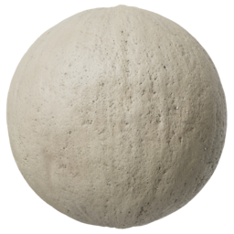</a> <b><a href="Ground010">Ground 010</a></b> by ambientCG · <a href="https://ambientcg.com/a/Ground010">source</a> | <a href="Ground011">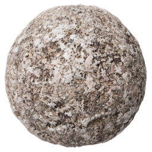</a> <b><a href="Ground011">Ground 011</a></b> by ambientCG · <a href="https://ambientcg.com/a/Ground011">source</a> | <a href="Ground012">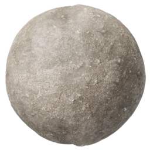</a> <b><a href="Ground012">Ground 012</a></b> by ambientCG · <a href="https://ambientcg.com/a/Ground012">source</a> |
| <a href="Ground013">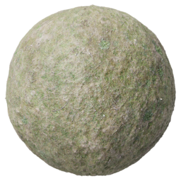</a> <b><a href="Ground013">Ground 013</a></b> by ambientCG · <a href="https://ambientcg.com/a/Ground013">source</a> | <a href="Ground014">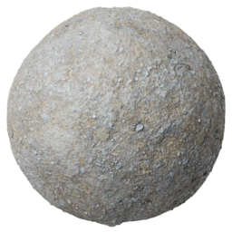</a> <b><a href="Ground014">Ground 014</a></b> by ambientCG · <a href="https://ambientcg.com/a/Ground014">source</a> | <a href="Ground015">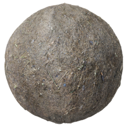</a> <b><a href="Ground015">Ground 015</a></b> by ambientCG · <a href="https://ambientcg.com/a/Ground015">source</a> | <a href="Ground016">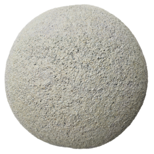</a> <b><a href="Ground016">Ground 016</a></b> by ambientCG · <a href="https://ambientcg.com/a/Ground016">source</a> |
| <a href="Ground017">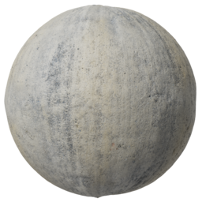</a> <b><a href="Ground017">Ground 017</a></b> by ambientCG · <a href="https://ambientcg.com/a/Ground017">source</a> | <a href="Ground018">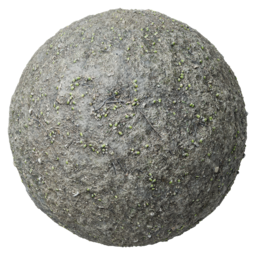</a> <b><a href="Ground018">Ground 018</a></b> by ambientCG · <a href="https://ambientcg.com/a/Ground018">source</a> | <a href="Ground019">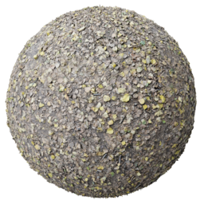</a> <b><a href="Ground019">Ground 019</a></b> by ambientCG · <a href="https://ambientcg.com/a/Ground019">source</a> | <a href="Ground020">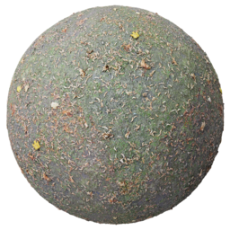</a> <b><a href="Ground020">Ground 020</a></b> by ambientCG · <a href="https://ambientcg.com/a/Ground020">source</a> |
| <a href="Ground021">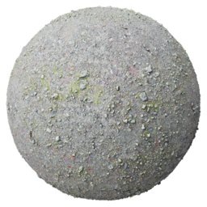</a> <b><a href="Ground021">Ground 021</a></b> by ambientCG · <a href="https://ambientcg.com/a/Ground021">source</a> | <a href="Ground022">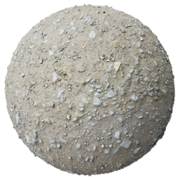</a> <b><a href="Ground022">Ground 022</a></b> by ambientCG · <a href="https://ambientcg.com/a/Ground022">source</a> |  |  |

---

Kept up to date by this repository's own [update workflow](.github/workflows/update.yml), with code and plan from [cc0-mirror](https://github.com/zuujis-cc0/cc0-mirror). Something wrong? [Open an issue there](https://github.com/zuujis-cc0/cc0-mirror/issues/new) or use the [private report form](https://games.zuujis.com/report).
